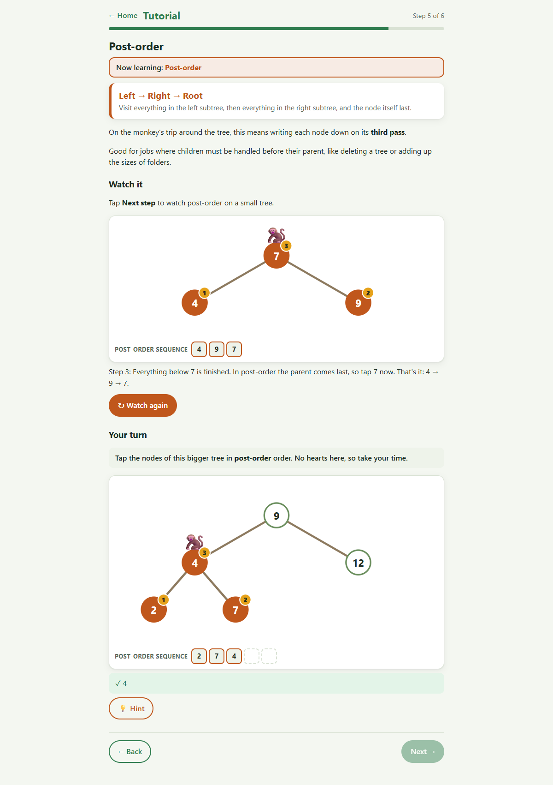
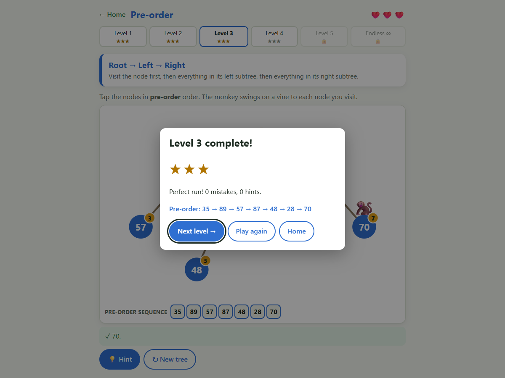
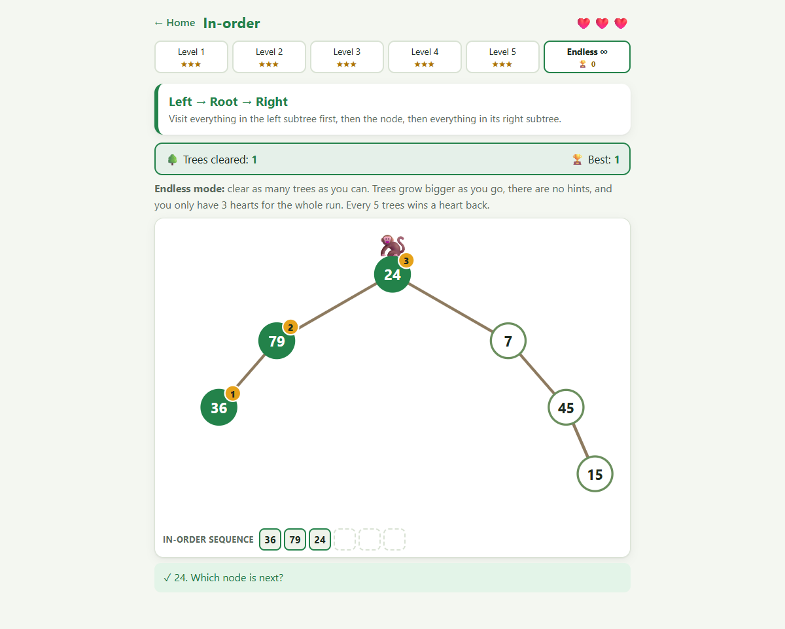
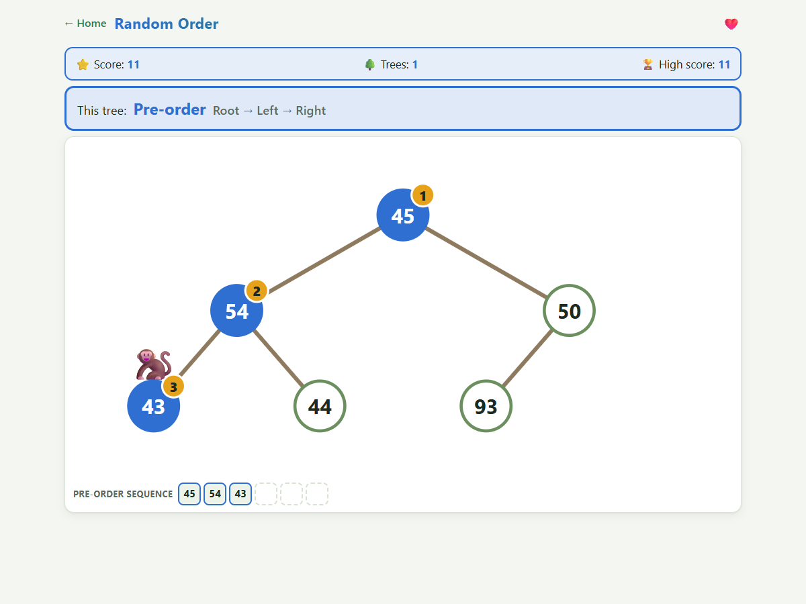
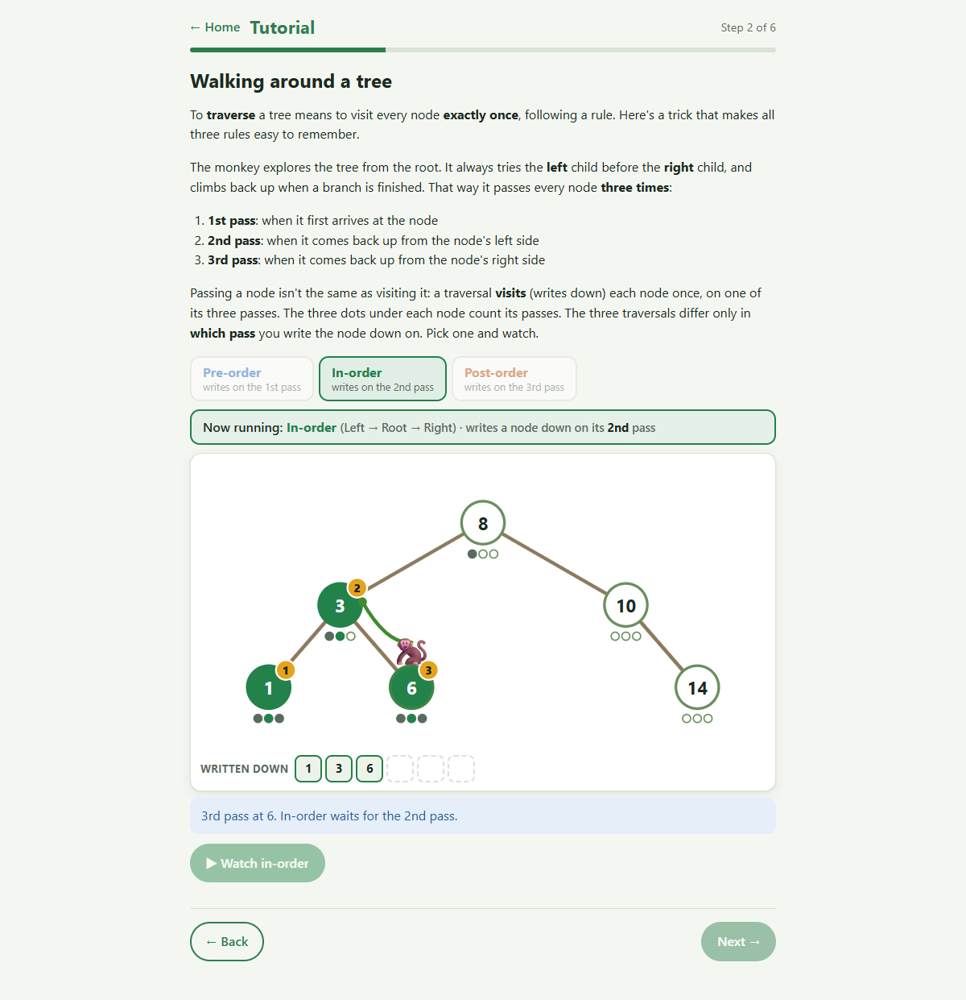
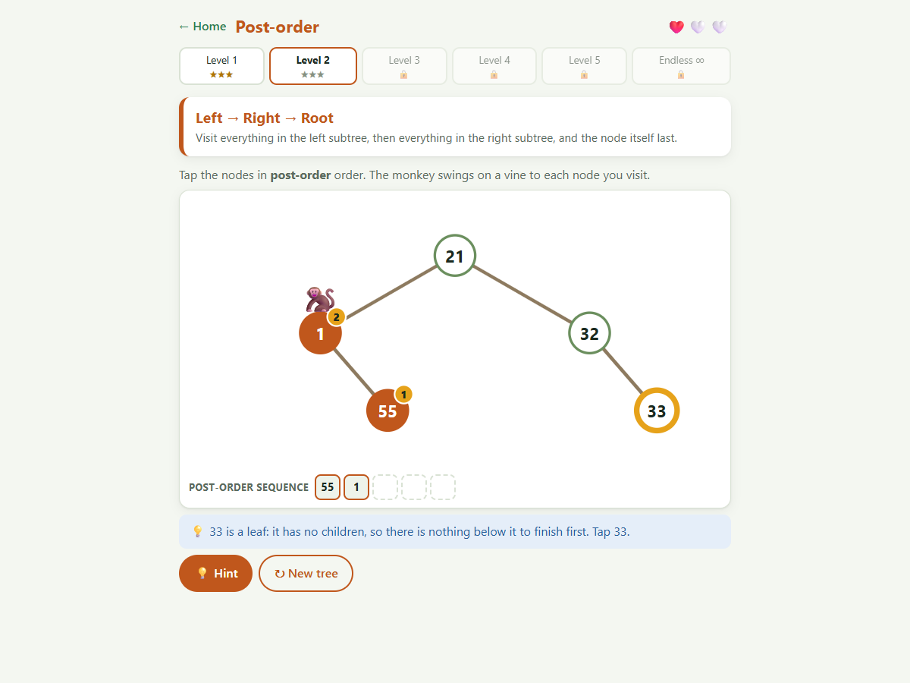
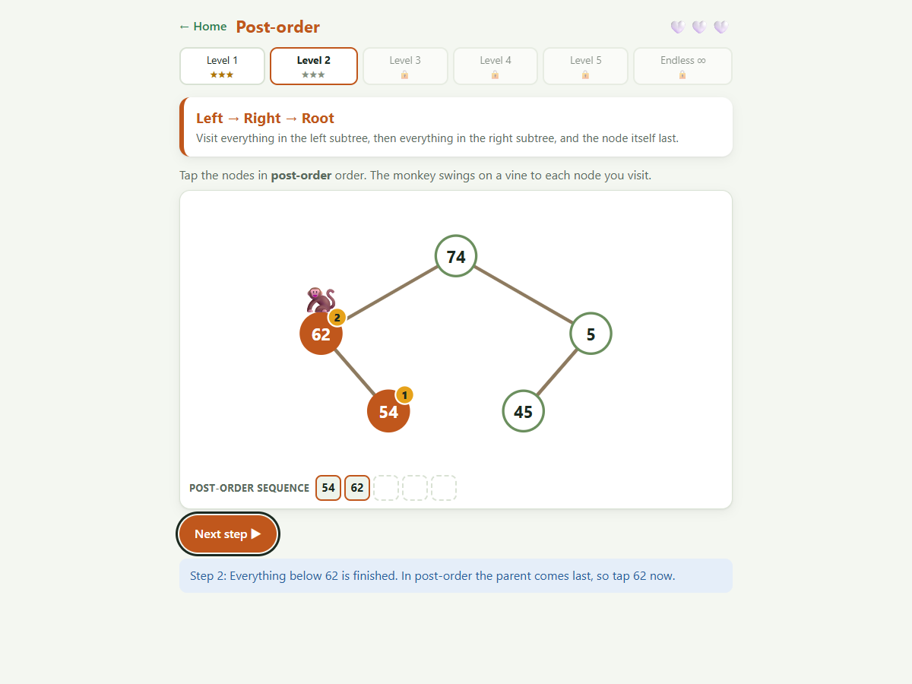
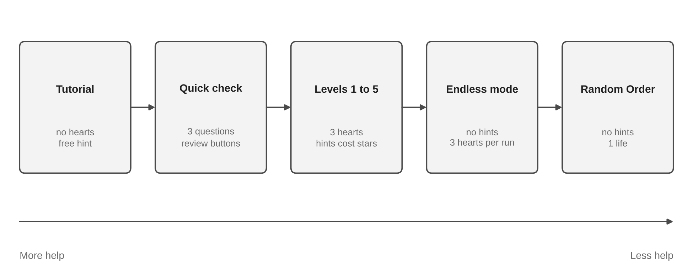
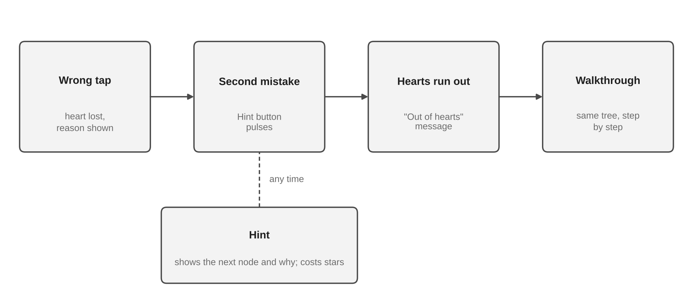

<!--
EDITOR NOTES (Galen). Delete this comment before the PDF export.

- This is the master file for the ID document. Paste each owner's section in place of its brief.
- Sections due to Galen: Sat 14 Nov 12:00. Final PDF: Sun 15 Nov 18:00. Submit: Sun 15 Nov 22:00.
- Every brief lists what the section must cover, the app features to point to, and a target length.
  "App hooks" are the concrete things in Tree Hop to name and, where useful, screenshot.
- Shared references live in references.md (Harvard style). Cite in text as (Author, Year).
- Appendix A is genai-acknowledgement.md. Append it at export time (see the export notes).
- Terminology to keep consistent across sections: "node", "root", "leaf", "subtree", "traversal",
  "pre-order / in-order / post-order", "the monkey's walk", "visit" (1st/2nd/3rd), "hearts",
  "hint", "walkthrough", "stars", "Endless mode", "Random Order mode".
-->

**Group:** 404: Name Not Found

**Members:**

| Name | Student number | Sections written |
|---|---|---|
| Galen Myburgh | [TODO Galen] | 1, 10, references, Appendix A, editing |
| Shekinah Maja | [TODO Galen] | 2, 3, 4, 5, 6 (content review) |
| Hendré Beyer | [TODO Galen] | 6 (storyboard), 7, 8 |
| Mthobisi Khoza | [TODO Galen] | 9 |
| Francois Scholtz | [TODO Galen] | App build; input to 9 |

**Repository:** https://github.com/404-name-not-found-cos750/cos212-app
**Live app:** https://cos212-tree-hop.vercel.app

---

# Introduction

This document describes the instructional design of **Tree Hop**, the COS212 app our group built for the COS750 final examination. It sets out what the app is meant to teach, who it is for, and why its content, presentation, motivation and assessment were designed the way they are. The software engineering side (methodology, requirements, architecture and testing) is covered in the separate SE document.

**Purpose.** The COS212 (Data Structures and Algorithms) lecturer asked for an app that gives students a tutor-style introduction to a topic *before* the lecture. The app may not assume any prior knowledge of the topic, and it has to include an assessment that gives extra scaffolding to students who are not yet comfortable with the work, so that they arrive at the lecture ready to build on it.

**Target learner.** The learner is a COS212 student at the University of Pretoria who has done introductory programming but has not yet been taught trees in the module. They may never have seen the words *root*, *leaf* or *traversal*. They use the app on their own, in a short session before the lecture, on a laptop or a phone. Section 3 analyses this learner in detail.

**Topic.** The app teaches one data structure, the **binary tree**, and one algorithm applied to it, **depth-first tree traversal** in its three classic orders: pre-order, in-order and post-order. Both fall under the Algorithmic Foundations (AL) knowledge area of CS2023 (Kumar et al., 2024). In CS2023 both are CS Core topics of the AL-Foundational knowledge unit: topic 9a, "Trees: Binary, n-ary, and search trees", and topic 11c, "uninformed depth/breadth-first tree search" (Kumar et al., 2024). The app also targets that unit's illustrative learning outcome for every algorithm in it: "Explain step-by-step how the algorithm operates." We first considered decision trees, but they are not on the Foundational data structures list, so we kept the game idea and moved it to binary trees. Decision record 001 in the repository (`docs/decisions/001-data-structure-and-algorithm.md`) gives the options we weighed and why traversal won: a traversal is a sequence of node visits, so every single tap can be checked and explained, and the three orders share one mental model that the tutorial can teach once and reuse.

**Tree Hop in one paragraph.** A monkey hops around a binary tree, and the student's job is to tell it which node to visit next. A six-step tutorial introduces the parts of a tree, then shows the monkey walking around the tree so that it passes every node three times; pre-order writes a node down on its first pass, in-order on its second and post-order on its third. One step per order follows, each with a step-by-step demonstration and a practice tree with hints, and the tutorial ends with a three-question quick check that links back to the steps the student got wrong. Three games (one per order) then offer five levels each on random trees of 3 to 12 nodes. Every wrong tap costs one of three hearts and explains why it was wrong; after two mistakes a hint is offered; when the hearts run out the app walks the student through that tree step by step. Stars reward accuracy and unlock the next level, an Endless mode, and finally a Random Order mode that mixes all three orders. Progress is saved in the browser on the student's own device.

**Structure of this document.** Section 2 describes the ID model we followed (ADDIE) and how its phases map onto our work. Sections 3 and 4 analyse the learner and state the learning objectives. Section 5 explains the learning theories behind the design, and sections 6 to 8 cover the content and storyboard, multimedia design and learning styles, and motivation. Section 9 describes the assessment, the scaffolding and the question bank. Section 10 concludes. Appendix A acknowledges our use of generative AI, with the prompts and tools used, as the examination specification requires.

---

# Instructional design model: ADDIE

ADDIE is a five-phase instructional design model: Analysis, Design, Development, Implementation and Evaluation (Branch, 2009). Each phase produces an output that feeds the next, and evaluation is meant to feed back into earlier phases.

We chose ADDIE over a rapid-prototyping model such as SAM, or Dick and Carey, for three reasons. It is well documented, so we could justify each step. Its phases give the ID document a clear structure. Its evaluation phase pairs directly with our usability test. In practice we did not run it as a strict waterfall. We worked iteratively, and phases overlapped.

| **Phase** | **What we did** |
|----|----|
| Analysis | Chose the topic against CS2023 (decision 001); wrote the learner analysis; drafted the learning objectives. |
| Design | Refined the objectives; storyboard and wireframes; designed the assessment (quick check, games, Random Order) and the scaffolding (hints, walkthrough). |
| Development | Francois built the app on the DevFS branch, merged by PR \#33; we reviewed the tutorial text against the objectives (section 6). |
| Implementation | Deployed to the live URL (https://cos212-tree-hop.vercel.app); presentation and demo. |
| Evaluation | Formative: the tutorial quick check and game feedback, and a usability test with students who have not done COS212 [TODO Galen: "(results in the SE document, section 7)" or "(planned; see the SE document, section 7)"]. Summative (not done): in a real COS212 rollout we would compare lecture-session performance and quiz results of students who used the app with those who did not. |

**Fit with Scrum.** ADDIE gives the instructional phases and the Scrum sprints gave the time boxes in which we worked through them (see the SE document).

**Limitation.** We reviewed the tutorial content against the objectives after the app had been built. The gaps we found (section 6) were therefore found late and had to be fixed in a working app, instead of being designed out. Next time we would agree the objectives and review the content before coding starts.

---

# Learner analysis

**Who the learner is.** A second-year-level COS212 student at the University of Pretoria. They have done introductory programming (variables, loops, functions, likely recursion) but have no prior knowledge of trees or traversal. The assignment says we may not assume any, so every term is taught from zero.

**Context of use.** The student works alone, before the lecture, in a short session on a laptop or phone, possibly on a slow connection. We designed for this: the app needs no login, has a phone layout and saves progress (stars, best scores, tutorial completion) in the browser's local storage on the device. The home screen tells students the tutorial takes about 10 minutes.

**Likely misconceptions and where the app addresses them.**

| **Misconception** | **Where the app addresses it** |
|----|----|
| Depth-first is the same as reading level by level | Quick check (step 6) uses the level-order sequence as a deliberate distractor. |
| In-order means left to right across the page | Step 4 uses the monkey's walk and a binary search tree so in-order comes out sorted. |
| Mixing up which pass each order writes on | Step 2 (the walk): each node is passed three times and the order only changes which pass writes it. Mistake explanations repeat the rule. |

**Differences between learners.** Confident, fast students get a challenge from Endless and Random Order. Anxious or struggling students get no hearts in tutorial practice, a hint button (nudged after two mistakes) and a step-by-step walkthrough when they run out of hearts. All text is English only and kept short.

**Accessibility.** In the app, every tree node can be reached and selected with the keyboard (Tab, then Enter or Space) and has a screen-reader label, feedback messages are announced as they change, and animations are switched off for students who have reduced motion set on their device. Each node's label also says whether it has been visited and in which position ("Node 30, visited, number 2"); this was added after the content review found it missing (section 6). Light and dark mode follow the device setting, and the colours were checked against WCAG 2.1 AA contrast (section 7).

---

# Learning objectives

**Overall goal.** Before the lecture, the student can produce and explain the pre-, in- and post-order traversals of a small binary tree. Levels follow the revised Bloom's taxonomy (Anderson and Krathwohl, 2001).

| **ID** | **The student will be able to...** | **Bloom's level** | **Taught / assessed** |
|----|----|----|----|
| LO1 | identify the root, a leaf, a child and a subtree of a binary tree. | Remember | Tutorial step 1 / step 1 tap tasks (root, leaf, right child; subtree is shown, not tapped) |
| LO2 | explain that a traversal visits every node exactly once, and that the three orders differ only in which of the three passes writes the node down. | Understand | Step 2 (the monkey's walk) / not directly assessed (see section 6) |
| LO3 | produce the pre-, in- and post-order sequence of a given tree. | Apply | Steps 3 to 5 / game levels 1 to 5 |
| LO4 | explain why a given node cannot be visited yet. | Analyse | Mistake explanations after a wrong tap / practice and games |
| LO5 | select the correct sequence from distractors, including a level-order distractor. | Analyse / Evaluate | Step 6 quick check / quick check |
| LO6 | apply the correct order when the order changes from tree to tree. | Apply / Analyse | Games / Random Order (the required order is shown for each tree) |

**Why the objectives stop at Analyse/Evaluate.** Tree Hop is a pre-lecture app that prepares students for the lecture. Create, for example writing the recursive traversal code, is left for the lecture and practicals.

**Scope.** BST insert/search, level-order (breadth-first) traversal and graphs are out of scope (decision 001). Level-order appears only as a distractor.

---

# Learning theories applied

## Constructivism and active learning

Students build understanding by doing rather than by reading definitions. In Tree Hop every tutorial step has a task (tap the root, tap a leaf, tap the right child of 3), and the games are entirely "tap the next node".

## Scaffolding and the zone of proximal development

Support should be given when needed and withdrawn as the student improves (Vygotsky, 1978; Wood, Bruner and Ross, 1976). Tree Hop moves from watching a demo, to practice with hints and no hearts, to games with three hearts and a hint button, to Endless with no hints, to Random Order with one heart (plus one more every 5 trees). The mechanics are covered in section 9.

## Cognitive load theory

Working memory is limited, so we limit what the student must hold at once (Sweller, 1988). The monkey's walk gives one mental model for all three orders instead of three separate rules. Trees start small and grow (levels 1 to 5 have 3, 5, 7, 9 and 12 nodes). Each tutorial step teaches one idea. The rule card ("Root, Left, Right") stays on screen during play, and the visit-order bar shows what has been written down so far.

## Behaviourism and immediate feedback

Each tap gets immediate right or wrong feedback, and stars and unlocks reinforce accurate work: a level earns 3 stars for no mistakes and no hints, 2 for up to two, and 1 otherwise (Skinner, 1953). The feedback is explanatory, not just "wrong", for example "In post-order, children come before their parent. 30 still has nodes below it to visit first." This moves it beyond pure drill.

## Mastery learning

A level must be cleared to unlock the next, and the quick check sends students back to the step they missed ("Review In-order"), so students move on only once they have completed the previous level (Bloom, 1968). This is a light form of mastery: one star is enough to unlock the next level, and the quick check advises but does not block.

## Summary

| **Theory** | **Design decision** | **App feature** |
|----|----|----|
| Constructivism | Learn by doing | A task in every tutorial step; games are tap-the-next-node |
| Scaffolding / ZPD | Support given then withdrawn | Hints, no hearts in practice, then hearts, Endless, Random Order |
| Cognitive load | One model, small steps | Monkey's walk; 3 to 12 node trees; rule card; visit-order bar |
| Behaviourism | Immediate, explained feedback | Right/wrong on each tap with explanation; stars and unlocks |
| Mastery learning | Clear a level to progress | Locked levels; quick check routes back to missed step |

---

# Content design and storyboard

## Content structure

Vocabulary (step 1), the walk (step 2), pre-order (3), in-order (4), post-order (5), quick check (6), then games. The walk comes before the individual rules so that students have one model to attach each rule to. Pre-order comes first because the node is written on arrival, which is the easiest to see.

## Worked examples

Step 3 links pre-order to copying a tree. Step 4 uses a binary search tree so in-order comes out sorted (10, 20, 30, 40, 60). Step 5 links post-order to deleting a tree or adding up folder sizes. Each gives the student a reason the order matters.

## Content review against the objectives

For issue \#19 we read the tutorial text in `app/js/tutorial.js` and the rule cards and mistake messages in `app/js/tree.js`. In general the content teaches from zero knowledge and the order works. We found these gaps.

| **LO** | **Screen that teaches it** | **Finding and suggested change (reason)** |
|----|----|----|
| LO1 | Step 1, Meet the tree | Works: three tap tasks with explanatory feedback. Gap 1 (fixed): "parent" was used ("no parent", feedback messages) but never defined. Step 1 now defines parent and child (PR \#39). Gap 2: the subtree is highlighted but never tapped, so it is taught but not assessed. Suggest one tap task, or accept this. |
| LO2 | Step 2, the monkey's walk | Clear explanation and three-pass animation, but it is watch-only and nothing later tests the idea directly. Suggest one prediction question (e.g. "On which visit does in-order write 3?") before the reveal, since this is the key idea in the app. |
| LO3 | Steps 3 to 5; game levels | Works: demo, then practice with no hearts. Each order has a rule card, a real-use link (copying, sorted output, deleting) and a hint button. No change. |
| LO4 | Mistake messages (tree.js) | Works: messages name the violated rule and the nodes involved, e.g. "In post-order, children come before their parent." The generic fallback ("Another node needs to be visited first") explains less. Suggest checking which taps reach it. |
| LO5 | Step 6, quick check | Works: level-order is a distractor, and wrong answers say what the sequence actually is. The quick check marks the tutorial done whatever the score; this is fine, but it advises rather than gates. |
| LO6 | Random Order | Works: a banner names the order and its rule before every tree, the order changes between trees (never the same order three times in a row), trees grow to 25 nodes, and there are no hints. After game over the student can watch the tree step by step. This tests applying the right rule, not recalling it, which matches the objective. |

Not corrected: The wording of the rule cards (Root, Left, Right and so on) and the three worked-example links needed no changes.

## Storyboard and screen flow

Tree Hop was built as a working prototype first (decision 002 in the repository), so the storyboard was drawn from the finished app, not before it. There is one frame per tutorial step and one per game state. Each caption says what the learner does and what feedback they get. The same screenshots are the wireframes in the SE document (section 5), where the full set of 17 figures, including phone and dark mode, is shown.

**Screen flow.** Home → Tutorial (6 steps) → Games (pre-order, in-order, post-order; levels 1 to 5, then Endless) → Random Order (unlocked at 30 of the 45 stars). When a student runs out of hearts, they get a walkthrough of that tree and then a fresh tree, not a "game over". The diagram is Figure 5.1 in the SE document.

### Tutorial: six learner-paced steps

In every step, **Next** stays disabled until the step's task is done, and there are no hearts to lose.

{width=60%}

{width=60%}

{width=60%}

{width=60%}

{width=60%}

{width=60%}

### Games: one level, from first tap to the result

{width=60%}

{width=60%}

{width=60%}

{width=60%}

{width=60%}

### After the levels: support fades

{width=60%}

{width=60%}

---

# Learning styles and multimedia design

## Several ways in, for every student

Students who open Tree Hop before the lecture arrive with different habits. Some want to see a picture first, some want the rule in words, and some only understand once they try it. Tree Hop does not ask the student which kind of learner they are and does not change the lesson to match. Instead, **every idea is presented in several ways at once**, so each student has more than one way in:

| Mode | How Tree Hop uses it | Where |
|---|---|---|
| **Visual** | Every tree is drawn as a diagram. The monkey (or the chosen avatar) swings on a vine to each node as it is visited. Each node gets a numbered badge in visit order, and the three orders have their own colours (pre-order blue, in-order green, post-order orange). | All tutorial steps and games |
| **Verbal (text)** | Every order has a short rule ("Root → Left → Right") and a one-sentence description on a rule card. Every tap gets a written sentence of feedback, and every hint and walkthrough step explains *why* a node is next. | Rule cards, feedback line, hints, walkthrough |
| **Active / hands-on** | The student does the traversal by tapping the nodes in order. In tutorial step 1 they learn the vocabulary by tapping the root, a leaf and a child. | Tutorial steps 1, 3–5; all games |
| **Reflective / self-paced** | The step-by-step demonstrations and walkthroughs move only when the student presses **Next step ▶**. The tutorial never moves on by itself. | Tutorial steps 3–5, walkthrough after running out of hearts |

The idea of matching teaching to a single preferred "learning style" is contested. Reviews have found little evidence that it improves learning (Pashler et al., 2008). This is why Tree Hop gives **multiple representations to everyone** rather than giving each student a style quiz. The design rationale for combining pictures and words comes from Mayer's cognitive theory of multimedia learning (Mayer, 2009), which the next subsection applies.

## Mayer's multimedia principles in Tree Hop

Mayer (2009) argues that people learn better from words and pictures together than from words alone, provided the material is designed so that it does not overload working memory. This links to cognitive load theory in section 5 (Sweller, 1988). Tree Hop applies the following principles.

| Principle (Mayer, 2009) | What it says | How Tree Hop applies it |
|---|---|---|
| **Multimedia** | Words and pictures together beat words alone. | No rule is only stated. Each order is shown on a real tree, and each sentence of feedback refers to a node the student can see ("30 still has nodes below it to visit first"). |
| **Pre-training** | Teach the names and parts of the system before the process. | Tutorial step 1 teaches *root*, *leaf*, *child* and *subtree* by tapping, before step 2 shows how a traversal moves through the tree. |
| **Signalling** | Highlight what matters. | Each order has a colour that is used consistently on its card, its rule card, the buttons and the sequence bar. The node being visited is highlighted, visited nodes get numbered badges, and the hint makes the next node pulse. In step 2, three dots under each node show which of the three passes writes it down, and the "Now running" banner names the order. In Random Order, a large coloured banner announces the order for each new tree. |
| **Spatial contiguity** | Put words next to the picture they describe. | The rule card is directly above the tree. The feedback sentence is directly below the tree and the sequence bar. The student never has to look somewhere else to find out why a tap was wrong. |
| **Temporal contiguity** | Show words and the matching picture at the same time. | The wrong node flashes red at the same moment as the explanation appears. During the demos, the node is visited and its reason is shown in the same step. |
| **Segmenting** | Break the lesson into learner-paced parts. | The tutorial is six short steps with a progress bar. **Next** only unlocks when the step's task is done, and the demos advance one node at a time on **Next step ▶**. |
| **Coherence** | Leave out what does not support learning. | The play screen has only the rule, the tree, the sequence bar, the feedback line and two buttons. There is no background music, no background image and no text that does not relate to the task. |
| **Personalisation** | A friendly, conversational style helps. | The feedback speaks to the student directly ("That's part of learning. Let's go through this tree together, one step at a time."), and a character (the monkey) acts as a guide. |

**Where Tree Hop does not follow a principle, and why:**

- **Modality and redundancy do not apply.** Tree Hop has no narration or sound, so words are always on-screen text. Narration could have reduced the visual load (the modality principle), but it would make the app unusable in a lecture hall or library without headphones, and recording it was out of scope.
- **Coherence is stretched by the avatars and the vine.** The vine animation and the unlockable avatars are partly decorative and could compete for attention. We kept them because they support motivation (section 8). The vine also shows *where the traversal goes next*, so it doubles as signalling. The avatar picker is only on the home page, never on the play screen. Students who set "reduce motion" on their device get no swinging animation at all.

## Accessibility as part of the multimedia design

A multimedia design is only effective if every student can perceive it, so accessibility was treated as part of the same design:

- **Colour is never the only cue.** Every right or wrong tap also gets a sentence of text, every order is named in words as well as coloured, and hints name the node to tap.
- **Screen readers:** feedback lines are `aria-live` regions, so each explanation is read out as it appears. Each tree is labelled with its shape ("Binary tree with root 50. 50: left child 30, right child 70; …"), so it can be followed without seeing it. Each node says whether it has been visited and in which position ("Node 30, visited, number 2"). Hearts, stars and progress bars have text labels.
- **Keyboard:** every node can be reached with Tab and chosen with Enter or Space, so the whole app can be used without a mouse or touch screen. The focus ring is a dashed ring in the text colour, so a focused node never looks like a hinted one. While a result dialog is open, focus stays inside it.
- **Reduced motion:** if the device asks for reduced motion, the swinging, pulsing and pop animations are switched off.
- **Light and dark mode** follow the device setting. The colours were checked against WCAG 2.1 AA contrast after the feature freeze, and the gold text, stars, green feedback and focus ring were darkened where they failed (SE document, section 5).
- **Phones:** the layout becomes one column below 620 px, the level bar wraps, and buttons are at least 44 px high.

## Screenshots

The same images are used in the SE document (section 5). The files are in `docs/se/img/`.

{width=60%}

{width=60%}

{width=60%}

---

# Motivation: the ARCS model

## Why motivation needs its own design

Tree Hop is used **before** the lecture, on the student's own time, and nobody checks whether they used it. A pre-lecture app that is accurate but dull will simply not be opened, or will be closed after the first screen. We therefore designed motivation as deliberately as the content, using Keller's **ARCS model** (Keller, 1987; Keller, 2010). ARCS says that a learner is motivated to learn when four conditions are met:

- **Attention:** their curiosity is caught and kept.
- **Relevance:** they see why the content matters to them.
- **Confidence:** they believe they can succeed if they put in the effort.
- **Satisfaction:** they feel good about what they have achieved.

## How Tree Hop applies each category

**Attention.**

- A character guides the student from the first screen: "Help the monkey visit every node." On every correct tap the monkey swings on a vine to the node.
- Every attempt uses a **new random tree**, so no two rounds look the same and there is always something new to look at.
- The modes change the challenge: levels → Endless (no hints) → Random Order, where the order changes on every tree and a large coloured banner pops up to announce it.
- Questions keep the student thinking instead of reading. Each level opens with "Where does pre-order start?", and the tutorial ends with a quick check.

**Relevance.**

- The app is framed as **preparation for the COS212 lecture**. The home page says so, and the tutorial card says it takes about 10 minutes.
- Each order is linked to a real use:
  - Pre-order is "good for copying a tree".
  - In-order on a binary search tree gives the values from smallest to largest; the practice tree in step 4 is chosen so that the student sees this happen.
  - Post-order is used "for jobs where children must be handled before their parent, like deleting a tree or adding up the sizes of folders".
- The game mechanics (levels, stars, hearts and unlocks) are familiar from mobile games most students already play, so there is nothing new to learn about *how* to play.

**Confidence.**

- Small first steps. Level 1 has only 3 nodes, and trees grow slowly (3, 5, 7, 9, 12 nodes), so early success comes quickly.
- Practice is safe. The tutorial practice has **no hearts**, so mistakes cost nothing while the student is still learning the rule.
- **Help arrives before the student gives up**:
  - every mistake is explained;
  - after 2 mistakes the Hint button lights up;
  - running out of hearts leads to a step-by-step walkthrough instead of a "game over".

  The wording is encouraging: "That's part of learning. Let's go through this tree together."
- **Personal control:**
  - the student chooses which game to play and when;
  - they can replay any unlocked level or ask for a new tree;
  - the demonstrations move only when the student presses **Next step**.

  Keller links this kind of control to confidence: success then feels like the student's own doing.
- **Clear success criteria.** The rule is always on screen. After each level, the summary shows the stars together with the number of mistakes and hints, so the student can see exactly what earned them.

**Satisfaction.**

- **Extrinsic rewards:**
  - Up to **3 stars per level**: 3 for no mistakes or hints, 2 for up to 2 mistakes and hints combined, 1 for finishing.
  - A star total per game on the home page.
  - Praise in the level summary: "Perfect run!", "Nicely done!", "You got there!".
  - Best scores saved for Endless and Random Order.
- **Unlocks:**
  - the next level;
  - Endless mode after level 5;
  - Random Order mode at **30 of the 45 stars**;
  - **avatars**: new characters that replace the monkey on every tree, unlocked at 10, 20, 30, 40 and 45 stars, and for long Endless and Random Order runs, with a "legendary" Dragon for unlocking all the others.
- **Natural consequences.** What the student has just learnt is used straight away on bigger trees and in Endless mode. In-order on the step 4 tree comes out in sorted order, which rewards understanding rather than luck.
- **Fairness (equity).** The star rules are the same for everyone, they depend only on mistakes and hints, and every tree at a level has the same number of nodes.

## Summary table

| ARCS category | Strategy (Keller, 1987) | Tree Hop feature |
|---|---|---|
| Attention | Perceptual arousal (novelty, surprise) | Monkey and vine animation, random trees each round, the Random Order banner, avatars |
| Attention | Inquiry arousal (pose questions) | "Where does pre-order start?" at the start of each level; the quick check; "Which node is next?" after a correct tap |
| Attention | Variability | Tutorial → levels → Endless → Random Order: different challenges with the same skill |
| Relevance | Goal orientation | Framed as COS212 lecture preparation; "About 10 minutes" |
| Relevance | Familiarity | Real uses of each order (copying, sorted BST output, deleting a tree, folder sizes); familiar game mechanics |
| Confidence | Learning requirements | Rule card always visible; stars shown with the mistakes and hints that earned them |
| Confidence | Success opportunities | 3-node first level, growing trees, tutorial practice without hearts, hints, walkthrough |
| Confidence | Personal control | Choose the game and level, new tree on demand, learner-paced Next step, hint on demand |
| Satisfaction | Natural consequences | Skills used immediately on bigger trees and in Endless; in-order on a BST comes out sorted |
| Satisfaction | Positive consequences | Stars, praise messages, unlocks, avatars, saved best scores |
| Satisfaction | Equity | Same star rules for everyone, based only on mistakes and hints |

## Risks and how we handled them

- **Hearts can feel punishing for anxious learners.** Losing hearts may discourage exactly the students who most need practice. This is why the tutorial practice has no hearts, every lost heart comes with an explanation, and running out leads to a walkthrough rather than a "game over" screen.
- **Rewards can become the goal.** Stars and avatars could lead students to chase rewards rather than understanding, and a student can restart a level with **New tree** to reset their mistakes before finishing. We accept this for a short, voluntary pre-lecture app. The rewards are tied to accurate traversals, and every mistake is still explained. It does mean the stars are a measure of effort and progress, **not a reliable assessment of mastery**; section 9 discusses this.
- **The final unlock was too far away.** Random Order first needed 40 of the 45 stars, which is close to a perfect run of all 15 levels. A goal that feels out of reach lowers confidence instead of building it, so we lowered it to 30 (an average of 2 stars per level).

---

# Assessment, scaffolding and question bank

This section shows how Tree Hop checks what a student knows, and how it helps a student who is struggling. It covers how learning is checked, what help the student gets, and the questions the app asks, with the learning objective each one tests.

## How the app checks learning

Tree Hop checks learning in three ways:

- **While playing.** Every tutorial task and every tap in a game is checked straight away. The student is told why the tap was right or wrong.
- **A quick check.** At the end of the tutorial, three multiple-choice questions on one tree (one for each traversal order) show the student which order they are least sure of.
- **Stars and scores.** These record how well the student did. They are for the student's own motivation.

There is no high-stakes test. The app is preparation for the lecture, not a mark for the module. Its aim is to find gaps and close them before the lecture, so every question comes with feedback or a way back to the right tutorial step.

## What students should be able to do

Every question in the app tests one of the learning objectives in section 4 (LO1 to LO6). Table 1 shows where each objective is taught and where it is checked, including the quiz questions and the game levels.

| **LO** | **Taught in** | **Checked by** |
|----|----|----|
| LO1 | Tutorial step 1 | Step 1 tasks: tap the root, a leaf and the right child of 3 |
| LO2 | Tutorial step 2 (the monkey's walk) | Not tested directly. The quick check relies on it |
| LO3 | Tutorial steps 3 to 5 | Practice trees in steps 3 to 5; quick check Q1 to Q3; game levels 1 to 5; Endless mode; Random Order mode |
| LO4 | The mistake explanations in the practice trees and in every game | Supported by feedback, not tested directly |
| LO5 | Quick check feedback, which names the order a wrong choice belongs to | Quick check Q1 to Q3, which include a level-order option |
| LO6 | Games, one order at a time | Random Order mode, where the required order is shown for each tree |

*Table 1: Where each objective is taught and checked.*

## How the app helps students who struggle

This extra help is called scaffolding. The student gets it when they need it, and it is taken away as they improve (Vygotsky, 1978; Wood, Bruner and Ross, 1976). The figure below shows how the help reduces as the student moves through the app.

{width=95%}

- **Tutorial:** No hearts. The hint is free. After 2 wrong taps the message adds: "Try the Hint button if you're stuck."
- **Levels 1 to 5:** Three hearts per attempt. Each mistake is explained. A hint costs stars. The next section describes this in detail.
- **Endless mode:** Three hearts for the whole run, with one heart back every 5 trees while below three. No hints. After the run ends, the student can watch a walkthrough of the tree they were on.
- **Random Order mode:** One heart, plus one more every 5 trees. No hints. A banner states the order and its rule for each tree. A walkthrough is offered at game over.

### What happens in a level

The next figure shows the help in a game level. The hint can be used at any time, not only after the second mistake.

{width=95%}

1. **Wrong tap:** The node flashes and the student loses one of three hearts. The message explains the rule that was broken. Tapping a node that was already visited costs nothing and says that each node is visited exactly once.
2. **Second mistake:** The Hint button pulses and the message adds: "Stuck? Tap Hint to see which node is next and why."
3. **Hint:** It highlights the correct next node and says why it is next. In a game it counts against the stars.
4. **Hearts run out:** The student sees "Out of hearts" and "That's part of learning. Let's go through this tree together, one step at a time." They can choose "Show me step by step".
5. **Walkthrough:** The same tree resets. Each press of "Next step" visits one node and states the reason. Then the student gets a new tree at the same level. A walkthrough earns no stars, because its only purpose is to teach.

### Help in the quick check

Each question allows one answer. A wrong answer highlights the correct option and explains it. If the student chose the level-order sequence, the message says: "That reads the tree level by level, top to bottom and left to right. It is a different traversal (breadth-first)." If they chose another order's sequence, the message names that order.

A score below 3 / 3 shows "Review Pre-order", "Review In-order" or "Review Post-order" buttons, one for each question missed. Each button jumps back to the matching tutorial step. A score of 3 / 3 shows "You're ready!".

### Moving through the tutorial

"Next" stays disabled until the student completes the step: the three taps in step 1, one full run of the walk in step 2, the practice tree in steps 3 to 5, and all three quiz questions in step 6. The student cannot click through without doing each step.

## Stars

Stars show how well a student did on a level. They count mistakes and hints together:

| **Stars** | **When the student earns them**       |
|-----------|---------------------------------------|
| 3 stars   | No mistakes and no hints              |
| 2 stars   | At most 2 mistakes and hints together |
| 1 star    | Any other finished level              |

*Table 2: How stars are earned.*

Each game has 5 levels, so there are 15 stars per game and 45 in total. The best result for each level is kept.

Finishing a level unlocks the next one, and finishing level 5 unlocks Endless mode. A total of 30 stars (out of 45) unlocks Random Order mode. Progress is saved in the browser on the student's own device. It is not sent to the lecturer. A lecturer view would be a useful extension.

## Question bank

This is a list of everything the app asks. No questions were added in code. In the tables, **Item** is what the student sees, **LO** is the objective it tests, and the last two columns show what happens when the student is wrong or needs help.

### Tutorial tasks

| **Item** | **LO** | **Bloom's** | **Feedback on a wrong answer** | **Help available** |
|----|----|----|----|----|
| Step 1, task 1: "Tap the root." (tree 8, 3, 10, 1, 6, 14) | LO1 | Remember | "{n} has a parent ({p}) above it, so it isn't the root." | Unlimited retries, no penalty |
| Step 1, task 2: "Now tap any leaf." | LO1 | Remember | "{n} still has children below it. Leaves are at the ends of the branches." | Unlimited retries |
| Step 1, task 3: "Tap the right child of 3." | LO1 | Remember | If 1 is tapped: "1 is the left child of 3. Look at the other side." Otherwise: "{n} isn't directly below 3." | On success, the left subtree of 8 (3, 1 and 6) is highlighted and named. Subtree is shown but not tested. |
| Step 2: watch the monkey's walk, one run per order | LO2 | Understand | No wrong answers. Each pass is labelled, for example "2nd pass at 3. Pre-order waits for the 1st pass." | Can be replayed for all three orders. Each run ends with the sequence it produced. |
| Step 3: pre-order practice, tree 50, 30, 20, 40, 70 (answer 50 → 30 → 20 → 40 → 70) | LO3 | Apply | Pre-order explanations (Table 6). After 2 wrong taps: "Try the Hint button if you're stuck." | A demo comes first (tree 7, 4, 9). Free hint. No hearts. |
| Step 4: in-order practice, tree 40, 20, 10, 30, 60 (answer 10 → 20 → 30 → 40 → 60) | LO3 | Apply | In-order explanations (Table 6), same nudge | Same. The tree is a binary search tree, so the answer comes out sorted. |
| Step 5: post-order practice, tree 9, 4, 2, 7, 12 (answer 2 → 7 → 4 → 12 → 9) | LO3 | Apply | Post-order explanations (Table 6), same nudge | Same |

*Table 3: Tutorial tasks.*

### Quick check (step 6)

All three questions use one tree: root 5, left child 8 (with children 1 and 4) and right child 2 (with right child 9). The four options are the pre-order, in-order, post-order and level-order sequences, in a different order each time. A wrong answer shows "Not quite.", then what the chosen option was, then the explanation for the correct answer.

| **Item** | **Correct answer** | **LO** | **Bloom's** | **Explanation shown** |
|----|----|----|----|----|
| Q1: "What is the pre-order sequence?" | 5 → 8 → 1 → 4 → 2 → 9 | LO3, LO5 | Apply, Analyse / Evaluate | "Pre-order starts at the root (5), then does all of the left subtree (8, 1, 4) before the right subtree (2, 9)." |
| Q2: "What is the in-order sequence?" | 1 → 8 → 4 → 5 → 2 → 9 | LO3, LO5 | Apply, Analyse / Evaluate | "In-order finishes the left subtree (1, 8, 4) before the root 5, then does the right subtree (2, 9)." |
| Q3: "What is the post-order sequence?" | 1 → 4 → 8 → 9 → 2 → 5 | LO3, LO5 | Apply, Analyse / Evaluate | "Post-order does the left subtree (1, 4, 8), then the right subtree (9, 2), and the root 5 last." |

*Table 4: Quick check. In every question the correct option is highlighted, and "Review" buttons go back to steps 3, 4 or 5.*

### Game levels, Endless mode and Random Order mode

The levels are the same for all three orders. Each uses a random tree with unique values from 1 to 99. Every item tests LO3 (Apply). Random Order mode also tests LO6. The feedback and hints depend on the order and are in Table 6.

| **Item** | **LO** | **Nodes** | **Max depth** | **Unlock rule** | **Help available** |
|----|----|----|----|----|----|
| Level 1 | LO3 | 3 | 1 | open | 3 hearts, explanation, hint, walkthrough |
| Level 2 | LO3 | 5 | 2 | level 1 finished | same |
| Level 3 | LO3 | 7 | 3 | level 2 finished | same |
| Level 4 | LO3 | 9 | 3 | level 3 finished | same |
| Level 5 | LO3 | 12 | 3 | level 4 finished | same |
| Endless mode | LO3 | starts at 5, +1 per tree, up to 15 | 3 | level 5 finished | 3 hearts for the run, one back every 5 trees while below 3, no hints, walkthrough at the end |
| Random Order mode | LO3, LO6 | 4 + 2 per tree, up to 25 | 2, 3 or 4 as the tree grows | 30 stars | 1 heart, +1 every 5 trees, no hints. The banner shows the order and its rule. The same order never comes up three times in a row. |

*Table 5: Game levels and modes.*

Random Order mode makes the student switch rules from tree to tree. They must recall which rule applies, with the rule card as support. That is why it comes last.

### Feedback and hints by order

When a tap is wrong, the app gives the first message that applies:

| **Order** | **Message when the tapped node is not allowed yet** |
|---|---|
| Pre-order | "In pre-order, a parent comes before its children. {up} is above {v} and hasn't been visited yet." Otherwise: "Left before right: {v} is in {a}'s right subtree, but {a}'s left subtree isn't finished yet." |
| In-order | "In in-order, a node waits until its whole left subtree is done. {v} still has nodes in its left subtree to visit first." Otherwise: "In in-order, {a} comes before its right subtree, and {v} is in that right subtree. Visit {a} before going right." |
| Post-order | "In post-order, children come before their parent. {v} still has nodes below it to visit first." Otherwise: the same left-before-right message as pre-order. |
| Any order, fallback | "Not {v} yet. Another node needs to be visited first. Remember the rule: {rule}." |

*Table 6: Feedback messages. {v} is the node tapped, {a} an ancestor of it, {up} an unvisited node above it.*

A hint names the next node and says why it is next. For example: "Pre-order starts at the root, the node at the top. Tap {v}." (pre-order), "In-order starts at the far left: from the root, keep going to the left child until there isn't one. That's {v}." (in-order), and "{v} is a leaf: it has no children, so there is nothing below it to finish first. Tap {v}." (post-order).

## Limitations

- Game trees are random, so difficulty within a level varies. A 5-node tree can be nearly a straight line or fairly balanced.
- The quick check has only three fixed questions on one tree. The tutorial counts as done whatever the score.
- LO4 is supported by feedback but not directly tested, and subtree (LO1) is shown but not tapped.
- Progress is saved per device and the lecturer cannot see it.
- Hearts may feel harsh to anxious students. The tutorial practice has none, and the walkthrough replaces a "game over".

---

# Conclusion

Tree Hop is a small, focused app: it teaches one data structure and one algorithm, binary trees and their depth-first traversals, to students who have not seen either before. The design choices described in this document all come back to that learner and that purpose. The tutorial teaches one mental model, the monkey's walk in which every node is passed three times, and builds the three orders on it, so the student does not have to memorise three unrelated rules. Every tap is checked immediately and every mistake is explained, and the support steps up only for students who need it: a hint after two mistakes, and a step-by-step walkthrough when the hearts run out. Stars, unlocks and harder modes give confident students a reason to keep going, while the tutorial practice and walkthroughs keep the experience safe for students who struggle.

We followed ADDIE for the instructional design and ran it in Scrum sprints alongside the software work. The usability test with students who had not done COS212 [TODO Galen: one sentence on what it showed, e.g. task completion and the main change it led to].

The prototype has clear limits. Progress stays on the student's device and is not reported to the lecturer, the tutorial quiz has only three questions, and the app covers depth-first traversal only. Natural next steps would be a lecturer view of class progress, a larger question bank tagged by objective, and further units on binary search trees and level-order traversal, reusing the same tree view and feedback engine. [TODO Galen: adjust to match what the team agrees are the most important limitations and next steps.]

---

<!--
References and Appendix A are kept in their own files and appended when the PDF is built:
  references.md            -> References (unnumbered)
  genai-acknowledgement.md -> Appendix A: GenAI acknowledgement (unnumbered)
The editor builds the PDF with pandoc (one command, title page, contents and numbered sections).
-->
