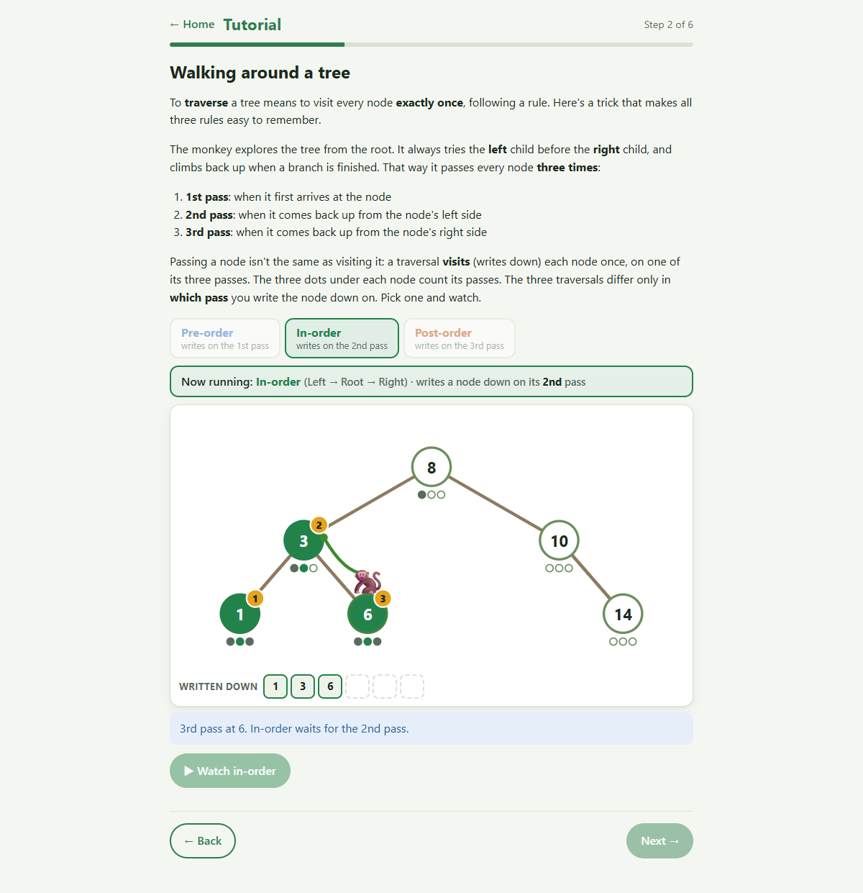
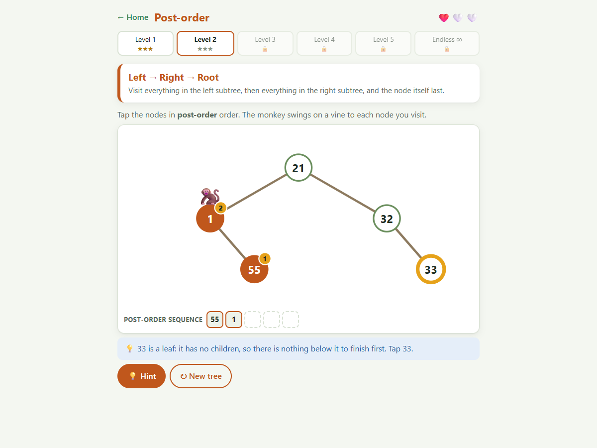
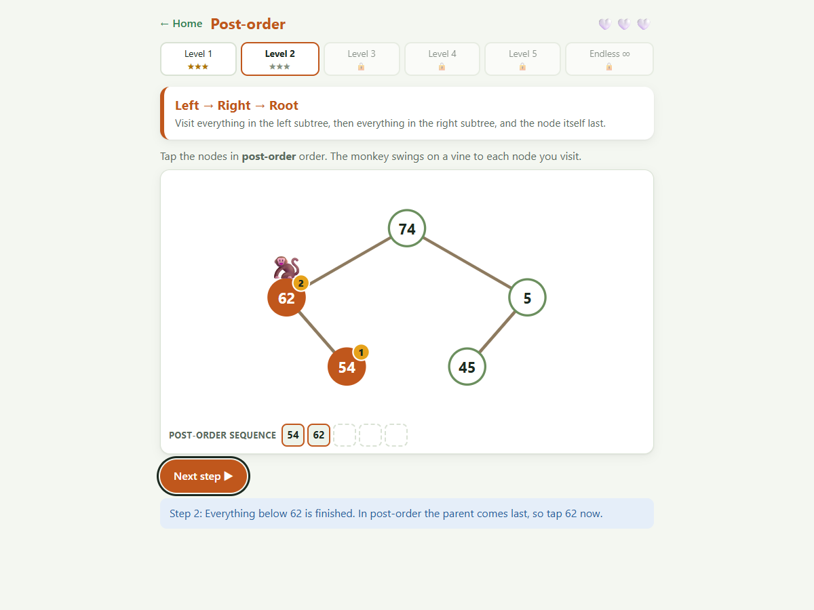

# Learning styles and multimedia design

> **Owner: Hendré.** Section 7 of the ID document. Draft for Galen to paste in place of the brief.

## 7.1 Several ways in, for every student

Students who open Tree Hop before the lecture arrive with different habits. Some want to see a picture first, some want the rule in words, and some only understand once they try it. Tree Hop does not ask the student which kind of learner they are and does not change the lesson to match. Instead, **every idea is presented in several ways at once**, so each student has more than one way in:

| Mode | How Tree Hop uses it | Where |
|---|---|---|
| **Visual** | Every tree is drawn as a diagram. The monkey (or the chosen avatar) swings on a vine to each node as it is visited. Each node gets a numbered badge in visit order, and the three orders have their own colours (pre-order blue, in-order green, post-order orange). | All tutorial steps and games |
| **Verbal (text)** | Every order has a short rule ("Root → Left → Right") and a one-sentence description on a rule card. Every tap gets a written sentence of feedback, and every hint and walkthrough step explains *why* a node is next. | Rule cards, feedback line, hints, walkthrough |
| **Active / hands-on** | The student does the traversal by tapping the nodes in order. In tutorial step 1 they learn the vocabulary by tapping the root, a leaf and a child. | Tutorial steps 1, 3–5; all games |
| **Reflective / self-paced** | The step-by-step demonstrations and walkthroughs move only when the student presses **Next step ▶**. The tutorial never moves on by itself. | Tutorial steps 3–5, walkthrough after running out of hearts |

The idea of matching teaching to a single preferred "learning style" is contested. Reviews have found little evidence that it improves learning (Pashler et al., 2008). This is why Tree Hop gives **multiple representations to everyone** rather than giving each student a style quiz. The design rationale for combining pictures and words comes from Mayer's cognitive theory of multimedia learning (Mayer, 2009), which section 7.2 applies.

## 7.2 Mayer's multimedia principles in Tree Hop

Mayer (2009) argues that people learn better from words and pictures together than from words alone, provided the material is designed so that it does not overload working memory. This links to cognitive load theory in section 5 (Sweller, 1988). Tree Hop applies the following principles.

| Principle (Mayer, 2009) | What it says | How Tree Hop applies it |
|---|---|---|
| **Multimedia** | Words and pictures together beat words alone. | No rule is only stated. Each order is shown on a real tree, and each sentence of feedback refers to a node the student can see ("30 still has nodes below it to visit first"). |
| **Pre-training** | Teach the names and parts of the system before the process. | Tutorial step 1 teaches *root*, *leaf*, *child* and *subtree* by tapping, before step 2 shows how a traversal moves through the tree. |
| **Signalling** | Highlight what matters. | Each order has a colour that is used consistently on its card, its rule card, the buttons and the sequence bar. The node being visited is highlighted, visited nodes get numbered badges, and the hint makes the next node pulse. In step 2, three dots under each node show which of the three passes writes it down, and the "Now running" banner names the order. In Random Order, a large coloured banner announces the order for each new tree. |
| **Spatial contiguity** | Put words next to the picture they describe. | The rule card is directly above the tree. The feedback sentence is directly below the tree and the sequence bar. The student never has to look somewhere else to find out why a tap was wrong. |
| **Temporal contiguity** | Show words and the matching picture at the same time. | The wrong node flashes red at the same moment as the explanation appears. During the demos, the node is visited and its reason is shown in the same step. |
| **Segmenting** | Break the lesson into learner-paced parts. | The tutorial is six short steps with a progress bar. **Next** only unlocks when the step's task is done, and the demos advance one node at a time on **Next step ▶**. |
| **Coherence** | Leave out what does not support learning. | The play screen has only the rule, the tree, the sequence bar, the feedback line and two buttons. There is no background music, no background image and no text that does not relate to the task. |
| **Personalisation** | A friendly, conversational style helps. | The feedback speaks to the student directly ("That's part of learning. Let's go through this tree together, one step at a time."), and a character (the monkey) acts as a guide. |

**Where Tree Hop does not follow a principle, and why:**

- **Modality and redundancy do not apply.** Tree Hop has no narration or sound, so words are always on-screen text. Narration could have reduced the visual load (the modality principle), but it would make the app unusable in a lecture hall or library without headphones, and recording it was out of scope.
- **Coherence is stretched by the avatars and the vine.** The vine animation and the unlockable avatars are partly decorative and could compete for attention. We kept them because they support motivation (section 8). The vine also shows *where the traversal goes next*, so it doubles as signalling. The avatar picker is only on the home page, never on the play screen. Students who set "reduce motion" on their device get no swinging animation at all.

## 7.3 Accessibility as part of the multimedia design

A multimedia design is only effective if every student can perceive it, so accessibility was treated as part of the same design:

- **Colour is never the only cue.** Every right or wrong tap also gets a sentence of text, every order is named in words as well as coloured, and hints name the node to tap.
- **Screen readers:** feedback lines are `aria-live` regions, so each explanation is read out as it appears. Each tree is labelled with its shape ("Binary tree with root 50. 50: left child 30, right child 70; …"), so it can be followed without seeing it. Each node says whether it has been visited and in which position ("Node 30, visited, number 2"). Hearts, stars and progress bars have text labels.
- **Keyboard:** every node can be reached with Tab and chosen with Enter or Space, so the whole app can be used without a mouse or touch screen. The focus ring is a dashed ring in the text colour, so a focused node never looks like a hinted one. While a result dialog is open, focus stays inside it.
- **Reduced motion:** if the device asks for reduced motion, the swinging, pulsing and pop animations are switched off.
- **Light and dark mode** follow the device setting. The colours were checked against WCAG 2.1 AA contrast after the feature freeze, and the gold text, stars, green feedback and focus ring were darkened where they failed (SE document, section 5.5).
- **Phones:** the layout becomes one column below 620 px, the level bar wraps, and buttons are at least 44 px high.

## 7.4 Screenshots

The same images are used in the SE document (section 5). The files are in `docs/se/img/`.

