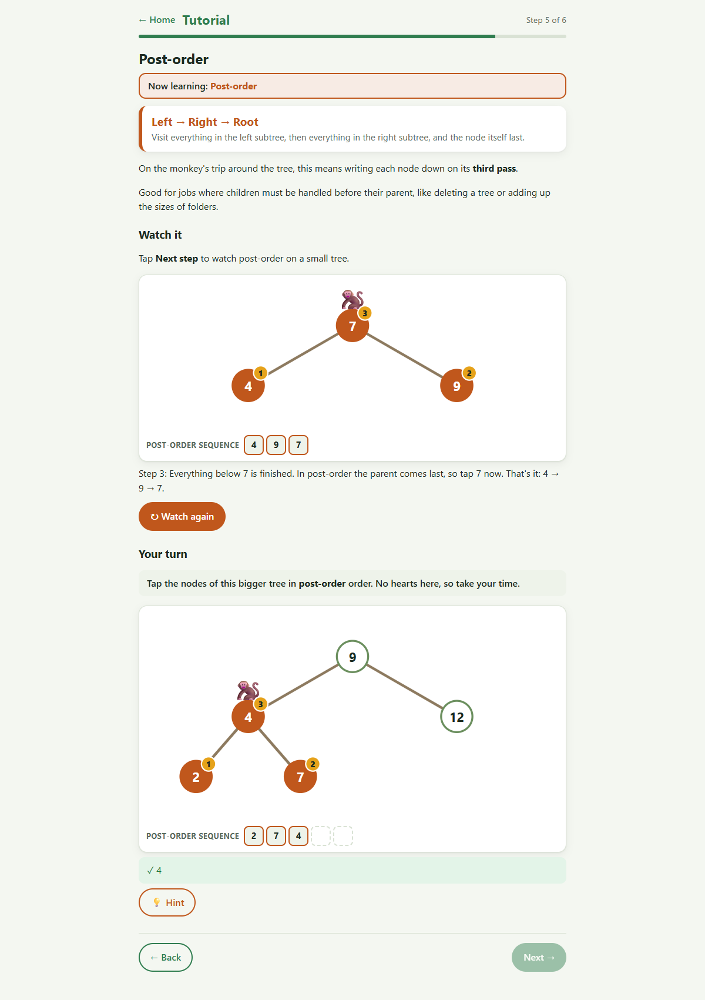
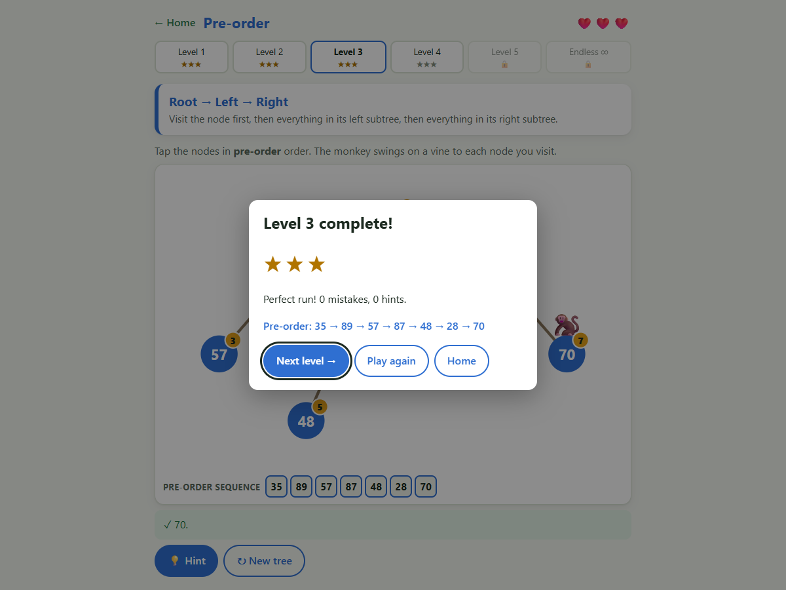
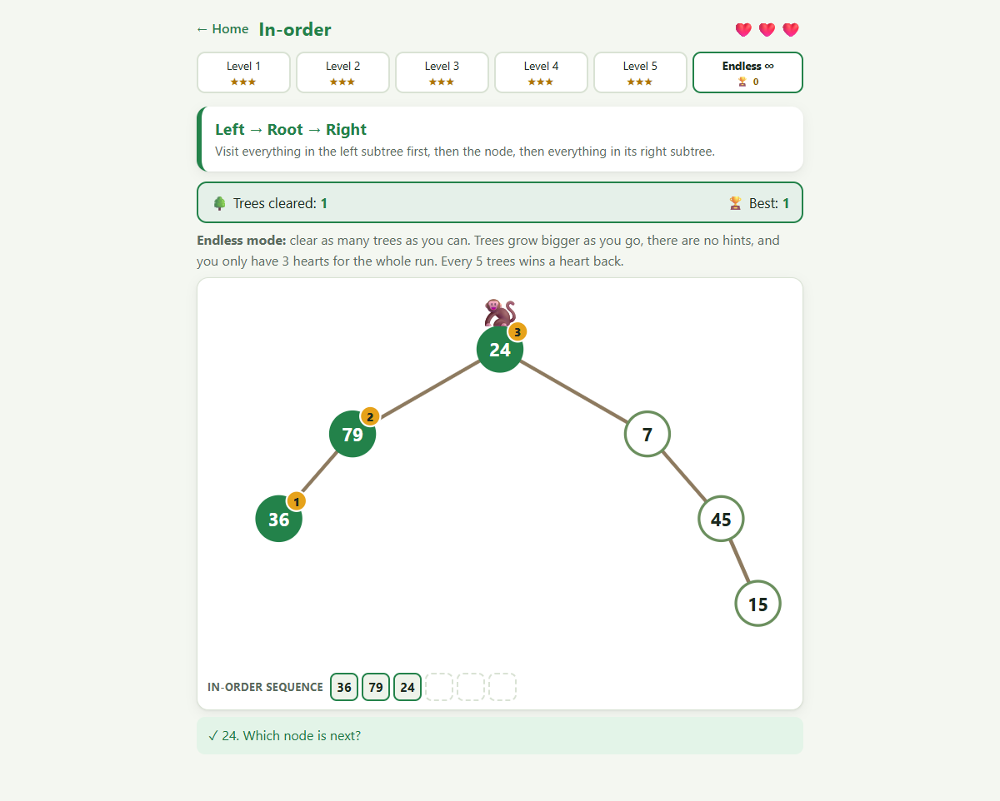
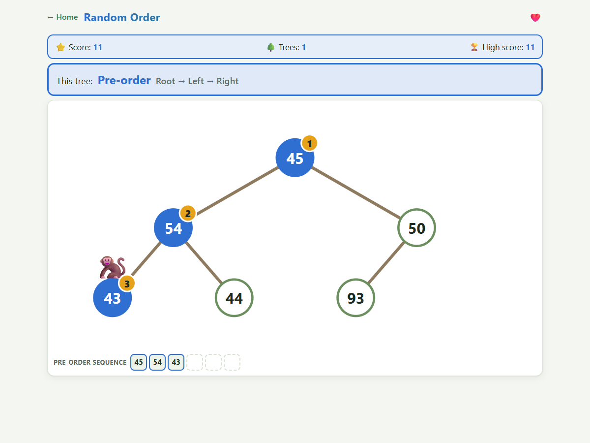

# Storyboard

> **Owner: Hendré** (issues #14, #17). The storyboard part of section 6 of the ID document. Shekinah's content structure, content review and worked examples come before it in the same section. Draft for Galen to paste in place of the "Storyboard" and "Screen flow" points of the brief.

## Storyboard and screen flow

Tree Hop was built as a working prototype first ([decision 002](../decisions/002-se-methodology.md)), so the storyboard was drawn from the finished app, not before it. There is one frame per tutorial step and one per game state. Each caption says what the learner does and what feedback they get. The same screenshots are the wireframes in the SE document (section 5), where the full set of 17 figures, including phone and dark mode, is shown.

**Screen flow.** Home → Tutorial (6 steps) → Games (pre-order, in-order, post-order; levels 1 to 5, then Endless) → Random Order (unlocked at 30 of the 45 stars). When a student runs out of hearts, they get a walkthrough of that tree and then a fresh tree, not a "game over". The diagram is Figure 5.1 in the SE document.

### Tutorial: six learner-paced steps

In every step, **Next** stays disabled until the step's task is done, and there are no hearts to lose.

### Games: one level, from first tap to the result

### After the levels: support fades

