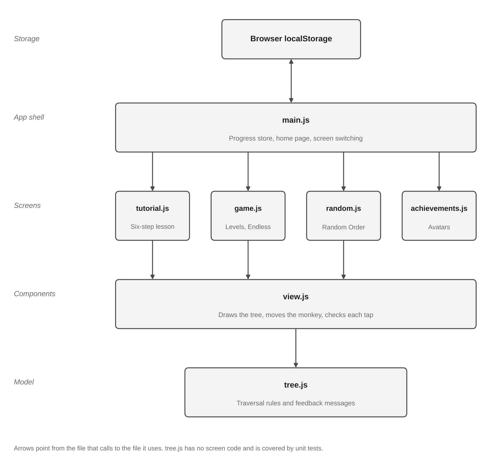
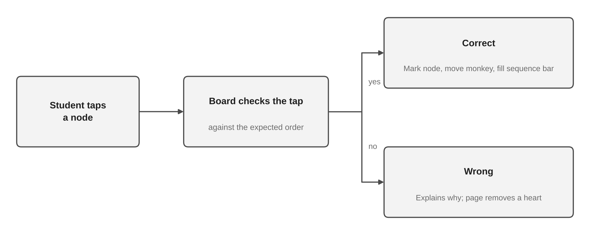
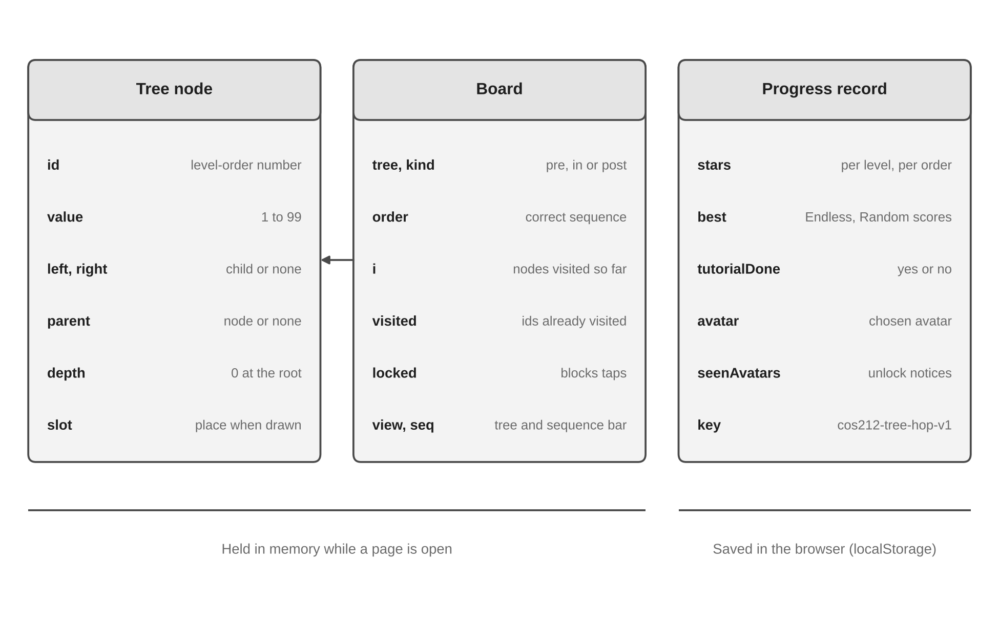
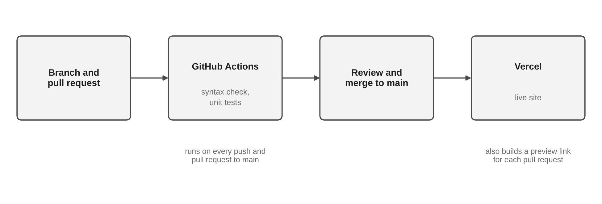

# Architecture and technology choices

This section explains how Tree Hop is built and why it is built that way. It covers how the code is organised, what the app stores, and why we chose these tools.

## The big picture

Tree Hop runs entirely in the web browser. There is no server and no database. The code is split into small files, and each file has one job. Figure 4.1 shows the files in layers. Each layer mostly uses the layer below it. The screens also save progress through the store in main.js.

{width=85%}

Table 4.1 explains what each file does.

| **File** | **Its job** |
|----|----|
| tree.js | Knows the rules. Builds trees, works out the correct order for pre-order, in-order and post-order, and writes the "why" messages. |
| view.js | Draws the tree, moves the monkey and checks each tap against the correct order. |
| tutorial.js | The six-step lesson and the quick check. |
| game.js | The three games, with five levels each, plus Endless mode. |
| random.js | Random Order mode, which mixes the three orders. |
| achievements.js | The avatars a student can unlock. |
| main.js | Saves progress, shows the home page and switches between screens. |

*Table 4.1: What each file does.*

**Why it is split this way.** The rules in tree.js are kept apart from the screens. The tutorial, the games and Random Order mode all reuse the same tree and the same tap checking. Only the cost of a mistake changes: hearts, hints and stars. This is how the app can give more help to beginners and less help to confident students without changing the rules code.

## What happens when a student taps a node

Figure 4.2 shows the path of a single tap.

{width=85%}

1.  The tree drawing in view.js passes the tapped node to the Board.

2.  The Board compares it with the next node in the correct order, which tree.js worked out when the tree was created.

3.  If it matches, the node is marked, the monkey jumps to it and the sequence bar fills in.

4.  If it does not match, tree.js writes the reason. The screen shows the reason and, in a game, removes a heart.

## What the app stores

Figure 4.3 shows the three kinds of data. A tree node and the board only exist while a screen is open. Only the progress record is saved.

{width=85%}

- **Where it is saved:** one small record in the browser (localStorage). Nothing is sent to a server, and there are no accounts.
- **What is saved:** best stars for each level and order, best Endless and Random Order scores, whether the tutorial is finished, and the chosen avatar.
- **What is not saved:** hearts, mistakes and hints. They only last while a level is open.
- **If the record is damaged or storage is blocked:** missing values are reset to defaults and the app keeps working. Progress is simply not kept. (This was a bug until PR #39; it is now fixed and tested, see section 6.)
- **Limit:** progress is tied to one browser on one device. Clearing browser data removes it, and the lecturer cannot see it.

## Technology choices

The main choice is in decision record 004: plain HTML, CSS and JavaScript with no framework and no build step. Table 4.2 lists the choices and the reason for each.

| **Area** | **What we chose** | **Why** |
|----|----|----|
| Language | Plain HTML, CSS and JavaScript, no framework | No setup for anyone on the team, works offline, and nothing can fail at build time before the demo. We rejected React with Vite and TypeScript because it needed build tools and React knowledge from everyone. |
| Drawing the tree | SVG | Each node is its own clickable element, so it works with keyboard and screen readers. It also scales to any screen size. |
| Screens | One page, with the screen named after \# in the address | Works on any static host without extra setup, and also when the page is opened as a file. |
| Saving progress | localStorage | No accounts or server needed, and no personal data leaves the device. |
| Testing | Node's built-in test runner | No packages to install. It tests tree.js, the file that holds the rules, and the loading of saved progress in main.js. |
| Hosting | Vercel, serving the app folder | The repository is private until the presentation, and GitHub Pages cannot host a private repository on a free organisation. The backups are an offline copy and a recorded video. |

*Table 4.2: Technology choices and reasons.*

All of these choices serve the same needs. The app must survive a live demo at the venue, five part-time students must be able to read and change it, and there is no data to keep on a server.

## How the code is tested and published

Two separate automatic steps run, as Figure 4.4 shows.

{width=85%}

- **GitHub Actions** runs on every push to main and every pull request to main. It checks every script in app/js for syntax errors and then runs the unit tests with npm test.
- **Vercel** publishes the app. A merge to main goes live, and every pull request gets a preview link.

The workflow tests the code and Vercel publishes it. The workflow does not publish anything itself.

## Weak points and what we would improve

- **Repeated code.** game.js and random.js repeat some code, such as the message line, the hearts display, the dialogs and the walkthrough. Sharing it would be the first clean-up.
- **Progress store in the shell file.** Store sits in main.js, so every screen depends on the shell. It could move into its own file.
- **Limited automatic testing.** Only the rules in tree.js and the loading of saved progress in main.js have unit tests. The screens are checked by hand, in the usability test and in rehearsals.
